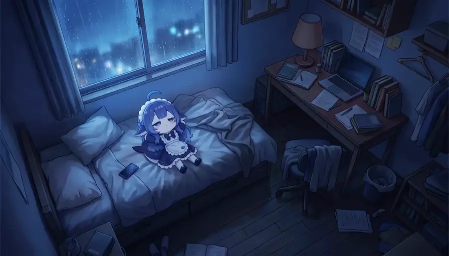
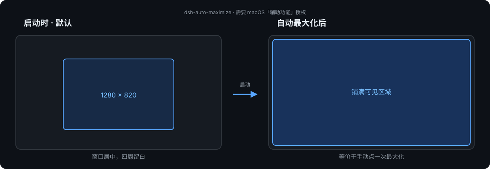

# DSH Desktop 开箱配置

一条命令，把刚装好的 DeepSeek Harness Desktop 变成这样：

<p align="center">
  
  
  
</p>
<p align="center">
  <sub><b>开机片头</b>　·　<b>动态壁纸</b>　·　<b>启动自动最大化</b></sub>
</p>

三个演示都是从**实际安装的插件素材**抽的帧，不是效果图：片头是内置 4 段中的「数字角色苏醒」**完整 7 秒**，壁纸是原片循环 6 秒。动图为 WebP，浏览器里会自动循环播放。

---

## 装了些什么

| # | 效果 | 来源 | 体积 | 需要你做什么 |
|---|---|---|---|---|
| 1 | **开机片头**：启动、新对话时全屏播视频，可钉住会话、可换片 | [NativeDog1/dsh-boot-animation](https://github.com/NativeDog1/dsh-boot-animation) | 9.5 MB | 无需操作 |
| 2 | **动态壁纸**：视频循环铺满窗口，配液态玻璃界面 | [elysia395/dsh-wallpaper-engine](https://github.com/elysia395/dsh-wallpaper-engine) | 28 MB | 首次选一次壁纸 |
| 3 | **启动自动最大化**：开窗口即铺满可见区 | [FideFei/dsh-auto-maximize](https://github.com/FideFeiPlane/dsh-auto-maximize) | 0.1 MB | **授「辅助功能」权限** |
| 4 | **动态壁纸素材**：「深夜大肥鱼」2 分 05 秒 | [QWEQ-CELL-DEL/dsh-whale-girl-wallpaper](https://github.com/QWEQ-CELL-DEL/dsh-whale-girl-wallpaper) | 8.3 MB | 脚本自动下载 |
| 5 | **持久终端**：shell 进程跨工具调用保活 | DSH 自带 | 0 | 无需操作 |
| 6 | **自动会话标题**：按对话内容刷新标题 | DSH 自带 | 0 | 无需操作 |
| 7 | **思维链翻译**：思考内容可机器翻译 | DSH 自带 | 0 | 无需操作 |

> 第 5/6/7 项是 DSH 随包自带、默认关闭的插件，本套脚本帮你打开。

---

## 30 秒开始

### 方式 A：丢给 AI（最省事，推荐）

把 **[AI-执行版.md](AI-执行版.md)** 整份发给你的 AI（Claude Code / Cursor / Codex / 另一个 DSH 都行），附一句：

> 按这个文件里「给 AI 的执行契约」帮我配置，遇到必须人工确认的点就停下来。

它会自检 → 安装 → 校验，只在下面两步停下来找你。

### 方式 B：自己跑

```sh
git clone https://github.com/PsycheLv/dsh-desktop-setup.git
cd dsh-desktop-setup
./setup-dsh-desktop.sh --check    # 体检，不改东西
./setup-dsh-desktop.sh            # 执行
./setup-dsh-desktop.sh --verify   # 重启后自检
```

前置：DSH Desktop 已安装，并**至少启动过一次**（要生成 profile）。

---

## 只有两步要你亲自动手

| 步骤 | 怎么做 | 为什么不能自动 |
|---|---|---|
| ① 授「辅助功能」 | 系统设置 → 隐私与安全性 → 辅助功能 → 勾选 **DeepSeek Harness** | macOS TCC 只能人点，任何脚本/插件都绕不过 |
| ② 完全重启 | `Cmd+Q` 退出，再打开（刷新页面不够） | 客户端插件是 immutable 缓存，必须换进程 |

> 想撤销？`./setup-dsh-desktop.sh --rollback`

---

## 常见问题

<details>
<summary><b>装完看不到片头 / 壁纸？</b></summary>

99% 是没完全重启。`Cmd+Q` 退出 App 再打开，不要只刷新页面。
</details>

<details>
<summary><b>背景是一片黑的？</b></summary>

三个原因叠加：macOS 上没有 Wallpaper Engine（插件不自带壁纸）→ 需要在壁纸库选一张；默认「暗化」0.5 太黑 → 调到 0.25；没选中壁纸。脚本会自动下载素材并预选。
</details>

<details>
<summary><b>自动最大化没反应？</b></summary>

看 `~/.dsh/auto-maximize.log`：出现 `maximized-bounds` 就成功；出现 `perm:` 说明辅助功能授权没做，授权后必须重启 App。若仍失败，把 `/usr/bin/osascript` 也加进辅助功能列表。
</details>

<details>
<summary><b>能不能做成一个插件，点一下全装好？</b></summary>

不能完整做到。DSH 的 bundle 是「配置层」而不是「安装器」：一个包依赖另一个 bundle 包，并不会让后者的配置生效；而 TCC 授权和重启本来就无法自动化。所以最终形态是「一个可执行文档 + 一个脚本」。
</details>

---

## 细节

| 文档 | 内容 |
|---|---|
| [AI-执行版.md](AI-执行版.md) | 给 AI 的完整契约 + 人工步骤 + 验证命令 + 坑表 |
| [ATTRIBUTION.md](ATTRIBUTION.md) | 完整署名、许可证、素材来源链、免责声明 |

**目录**

```
AI-执行版.md          给 AI / 人看的完整手册
setup-dsh-desktop.sh  --check / apply / --verify / --rollback
docs/demo/            演示动图（片头抽帧、壁纸抽帧、最大化示意）
ATTRIBUTION.md        署名与出处
```

---

## 致谢与出处

功能都来自这些作者，**请给上游点 Star**（本仓库只做安装编排和说明）：

| 组件 | 作者 | 许可证 |
|---|---|---|
| [DeepSeek Harness](https://github.com/deepseek-ai/deepseek-harness) | DeepSeek | 见官方仓库 |
| [dsh-boot-animation](https://github.com/NativeDog1/dsh-boot-animation) | NativeDog1 | **BSD-3-Clause** |
| [dsh-wallpaper-engine](https://github.com/elysia395/dsh-wallpaper-engine) | elysia395 | MIT |
| [dsh-auto-maximize](https://gitee.com/FideFei/dsh-auto-maximize) | FideFei | MIT |
| [dsh-whale-girl-wallpaper](https://github.com/QWEQ-CELL-DEL/dsh-whale-girl-wallpaper) | QWEQ-CELL-DEL | MIT |

「蓝色大肥鱼 / 鲸鱼娘」是社区同人形象（原创「溟月」— 上善无形；「女仆鲸鱼娘」定型 — ZipZipPipe），**CC BY-NC-SA 4.0，禁止商用**。
本仓库不转载任何第三方视频/图片原文件：壁纸由安装脚本运行时下载并做 SHA-256 校验；演示动图是从上游素材抽的帧。
详见 [ATTRIBUTION.md](ATTRIBUTION.md)。

本仓库文档与脚本：**MIT**。
